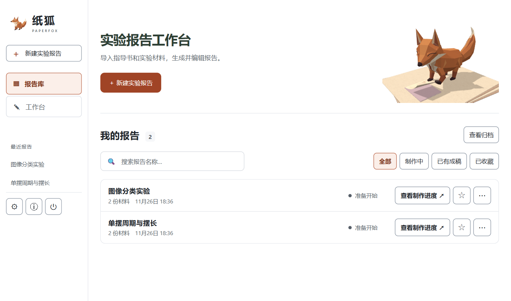
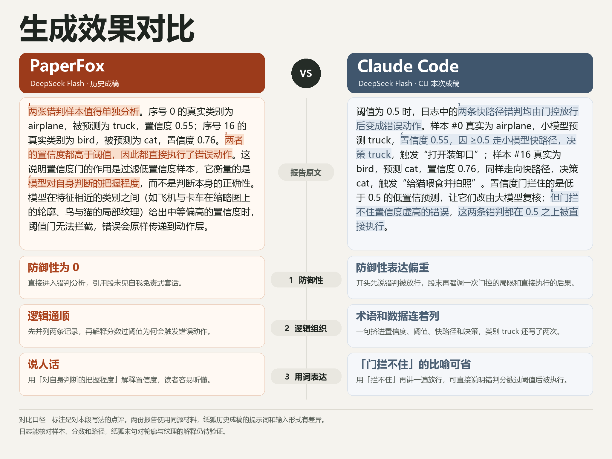

  

<h1 align="center">纸狐 PaperFox</h1>

把实验指导书、代码和已有结果整理成实验报告，在 Windows 桌面上阅读、改稿和导出 PDF。

  <strong><a href="https://github.com/ezalbxx/PaperFox/releases/latest/download/PaperFox-Windows-x64.zip">↓ 下载 Windows x64 便携版</a></strong>
  · <a href="https://github.com/ezalbxx/PaperFox/releases">更新记录</a>
  · <a href="docs/guide.md">使用指南</a>
  · <a href="https://github.com/ezalbxx/PaperFox/issues">反馈问题</a>

Windows 10 / 11 · 完整解压后双击 PaperFox.exe

## 三步写出一份报告

1. **打开纸狐**。完整解压便携包，双击 `PaperFox.exe`。在「模型设置」选择支持工具调用的模型。
2. **导入实验材料**。新建报告，选择实验材料目录和指导书。学校有单独的模板时，可以一并上传。
3. **阅读、改稿、导出**。查看制作进度。报告保存后，可以选中正文讨论改法，或下载排版好的 PDF。

## 纸狐会处理什么

- **从材料写报告**。读取指导书、代码、Notebook、日志、表格和图表，根据已有结果组织正文。可用材料和实际导入目录在工作台可查。
- **把实验问题说清楚**。纸狐会在出稿前尝试处理措辞等可自行修订的问题。「实验与数据反馈」集中展示缺测、缺少依据的结果和影响结论的数据问题。
- **保留改稿过程**。在原文上选句讨论，采用改稿后保留新版本，也可以比较历史版本。桌面工作台使用同一套本机报告库。

## 生成效果对比

下图并排展示 PaperFox 和 Claude Code 对同一组实验日志的报告原文，从防御性、逻辑组织和用词表达三个维度作对照。两边均使用 DeepSeek Flash，纸狐一栏采用历史成稿。

## 数据与模型

报告保存在 `%LOCALAPPDATA%\PaperFox\Reports`，API Key 由 Windows 加密保存。用于撰写报告的材料会提交给所选模型，云端服务按其规则计费。纸狐支持多家云端模型和本地 Ollama。[查看支持格式、模型设置与源码启动方式](docs/guide.md)

  <a href="https://ezalbxx.github.io/PaperFox/">项目主页</a>
  · <a href="https://github.com/ezalbxx/PaperFox/issues">提交问题或建议</a>

